# KnowledgeFlow 后端项目学习手册

> 适用读者：掌握 Java、Spring Boot、MySQL 基础，希望能看懂、修改并在面试中讲清本项目的开发者。  
> 证据口径：本文以当前仓库源码为准。标为“当前实现”的内容可由源码验证；标为“局限/假设”的内容不会被包装成已经实现的能力。  
> 建议用法：先按 Learning Map 建立全局心智模型，再沿第 3 章路线读源码，最后完成第 19 章实战。

<div class="concept">
<strong>一句话定位</strong><br/>
KnowledgeFlow 是一个以个人知识管理为主线的 Spring Boot 单体后端：把笔记、RSS/GitHub/arXiv/上传文件沉淀到 MySQL，再异步投影到 Elasticsearch、Qdrant 和 Neo4j，提供全文/语义/混合搜索、RAG 问答、知识图谱和 SM-2 复习。
</div>

## Learning Map

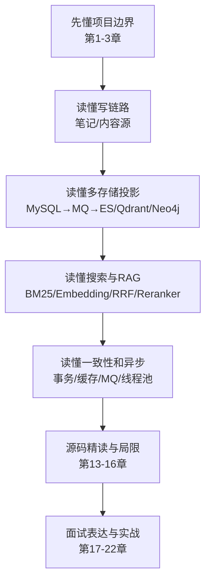

| 学习层 | 先回答的问题 | 关键源码 | 达标标准 |
|---|---|---|---|
| 业务层 | 系统为谁解决什么问题？ | 各模块 `controller` | 能说出 6 条核心用例 |
| 应用层 | 请求如何编排领域与基础设施？ | `*ServiceImpl`、Listener、Consumer | 能画出保存笔记和 RAG 时序图 |
| 数据层 | 哪个库是事实源，哪些是投影？ | Entity、Mapper、Repository | 能解释 MySQL/ES/Qdrant/Neo4j 的职责边界 |
| AI 层 | 召回、精排、生成如何串联？ | `RagRetriever`、`SemanticChunker` | 能区分 bi-encoder 与 cross-encoder |
| 工程层 | 如何保证安全、性能、可恢复？ | Config、MQ、测试 | 能指出当前至少 5 个生产缺口 |

---

## 1. 项目全景

### 1.1 系统能力

| 能力域 | 用户能力 | 后端核心 |
|---|---|---|
| 用户与安全 | 注册、登录、资料、GitHub OAuth | Spring Security、JWT、BCrypt、Redis 验证码 |
| 笔记 | CRUD、文件夹、版本、双链、公开社区 | MyBatis-Plus、MySQL 事务、MinIO |
| 内容聚合 | RSS、GitHub、arXiv、文件导入 | Scheduler、RabbitMQ、适配器、Tika/Jsoup |
| 搜索 | 全文、语义、混合、全局搜索 | Elasticsearch BM25、Qdrant、RRF、Reranker |
| AI | RAG 对话、流式回复、摘要、标签、复习题 | LangChain4j、Qwen Embedding、DeepSeek Chat |
| 图谱 | 稳定双链、图遍历、AI 相关边 | MySQL `note_link` 事实源、Neo4j 投影 |
| 学习 | 到期复习、AI 出题、复习统计 | SM-2、MySQL、AI 调用 |

### 1.2 总体架构

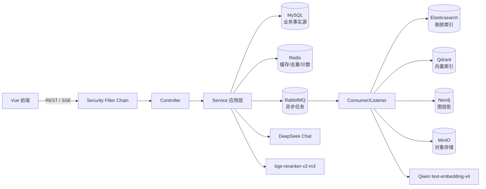

<div class="concept">
<strong>最重要的架构认识</strong><br/>
MySQL 保存用户可修改的业务真相；ES、Qdrant、Neo4j 是可以重建的派生投影。理解这一点，才能正确处理事务、一致性、删除和索引重建。
</div>

### 1.3 技术栈与版本

版本以 [`pom.xml`](pom.xml) 和 [`docker-compose.yml`](docker-compose.yml) 为准：Java 17、Spring Boot 3.5.9、MyBatis-Plus 3.5.9、LangChain4j 0.32.0、MySQL 8、Redis 7、RabbitMQ 3.12、Elasticsearch 8.17、Neo4j 5.15、Qdrant、MinIO。

### 1.4 架构风格

这是“按业务模块分包的模块化单体”，不是微服务。模块在同一 JVM、同一 Maven 工程内，通过 Java 调用、本地事件和 RabbitMQ 协作。它已经有服务化边界意识，但没有独立部署、独立数据库和分布式服务治理。

---

## 2. 项目目录结构

```text
KnowledgeFlowPlatform/
├── src/main/java/com/ray/knowledgeflow/
│   ├── common/                 # Result、异常、通用安全/文件/URL 工具
│   ├── config/                 # Security、AI、Redis、RabbitMQ、事务、线程池
│   ├── security/               # JWT 过滤器、UserPrincipal、UserDetailsService
│   └── module/
│       ├── user/               # 用户、关系、消息、OAuth
│       ├── note/               # 笔记、目录、版本、双链、互动
│       ├── content/            # 内容源、抓取、清洗、文件导入
│       ├── search/             # ES/Qdrant、混合检索、索引消息
│       ├── ai/                 # 对话、RAG、分块、重排、记忆
│       ├── graph/              # Neo4j 图投影与查询
│       ├── spaced/             # SM-2 复习与 AI 出题
│       └── dashboard/          # 聚合统计
├── src/main/resources/
│   └── application.yml        # dev/test/prod 与 RAG 参数
├── src/test/java/             # 单元、切片、RAG、权限、性能、集成测试
├── docker/                    # MySQL/Redis/Neo4j 配置与增量 SQL
├── reranker-service/          # 本机 cross-encoder HTTP 服务
├── frontend/                  # Vue 前端
├── docker-compose.yml         # 按 profile 启动基础设施
└── start.sh                   # 基础设施启动脚本
```

### 2.1 模块内约定

典型模块采用 `controller → service/interface + service/impl → mapper/entity`。跨进程异步用 `message/producer/consumer`；事务提交后的 JVM 内协作用 `event/listener`；ES/Neo4j 使用各自的 `repository`。

<div class="source-focus">
<strong>阅读提醒</strong><br/>
不要从 Entity 开始逐文件扫。先从 Controller 找用例，再到 Service 看业务不变量，之后跟到 Mapper/Repository、事件和消息；DTO/Entity 只在需要理解输入输出与持久化时打开。
</div>

---

## 3. 源码阅读路线

### 3.1 推荐的五轮阅读

1. **第一轮：入口和边界（1 小时）**  
   [`KnowledgeFlowApplication`](src/main/java/com/ray/knowledgeflow/KnowledgeFlowApplication.java) → [`SecurityConfig`](src/main/java/com/ray/knowledgeflow/config/SecurityConfig.java) → 各 Controller。
2. **第二轮：一条完整写链路（2 小时）**  
   [`NoteController`](src/main/java/com/ray/knowledgeflow/module/note/controller/NoteController.java) → [`NoteServiceImpl`](src/main/java/com/ray/knowledgeflow/module/note/service/impl/NoteServiceImpl.java) → `NoteSavedEvent` → 搜索/图谱/AI Listener → RabbitMQ Consumer。
3. **第三轮：搜索与 RAG（3 小时）**  
   [`SearchServiceImpl`](src/main/java/com/ray/knowledgeflow/module/search/service/impl/SearchServiceImpl.java) → [`EmbeddingService`](src/main/java/com/ray/knowledgeflow/module/search/service/EmbeddingService.java) → [`RagRetriever`](src/main/java/com/ray/knowledgeflow/module/ai/service/RagRetriever.java) → [`Reranker`](src/main/java/com/ray/knowledgeflow/module/ai/service/Reranker.java)。
4. **第四轮：一致性与工程化（2 小时）**  
   [`TransactionConfig`](src/main/java/com/ray/knowledgeflow/config/TransactionConfig.java)、[`RabbitMQConfig`](src/main/java/com/ray/knowledgeflow/config/RabbitMQConfig.java)、[`AsyncConfig`](src/main/java/com/ray/knowledgeflow/config/AsyncConfig.java)、Redis 互动计数。
5. **第五轮：测试反向理解设计（2 小时）**  
   先读 [`RagFlowTest`](src/test/java/com/ray/knowledgeflow/module/ai/service/RagFlowTest.java)、[`SearchServiceHybridTest`](src/test/java/com/ray/knowledgeflow/module/search/service/impl/SearchServiceHybridTest.java)、[`NoteLinkServiceTest`](src/test/java/com/ray/knowledgeflow/module/note/service/NoteLinkServiceTest.java)，再回看实现。

### 3.2 每次读类时问四个问题

- 它维护什么业务不变量，例如“只能访问自己的对话”？
- 它在哪个事务里，提交前后分别发生什么？
- 外部依赖失败时是重试、降级、回滚还是丢失？
- 数据的权威版本在哪里，派生版本如何重建？

---

## 4. 核心业务流程

### 4.1 笔记创建/更新与多索引同步

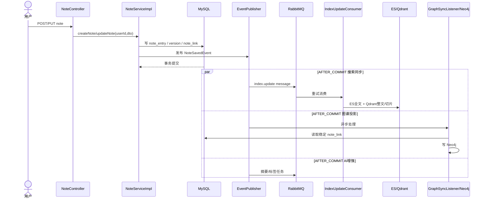

为什么先写 MySQL 再同步索引？因为用户数据必须原子提交，而搜索、向量和图谱属于可重建投影。`AFTER_COMMIT` 避免数据库回滚后却产生“幽灵索引”。但当前没有事务 Outbox，提交后投递 RabbitMQ 失败仍可能造成短暂或永久不一致。

### 4.2 内容源抓取

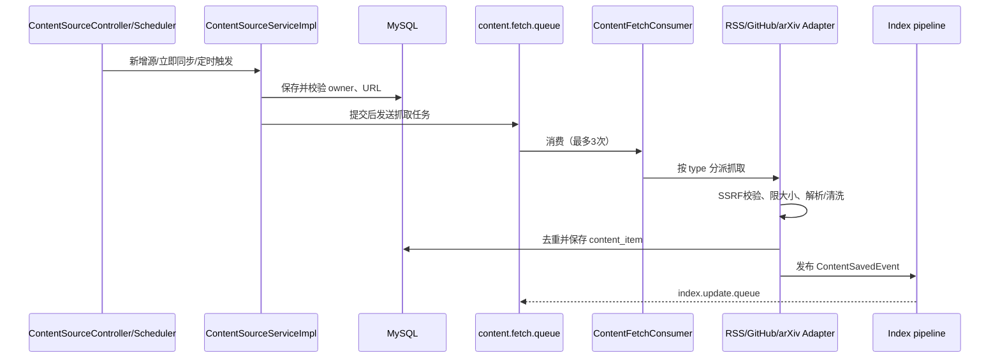

### 4.3 全文、语义、混合搜索的边界

| 入口 | 召回源 | 排序 | 是否 Reranker | 适合场景 |
|---|---|---|---|---|
| 全文搜索 | Elasticsearch | BM25 + `title^3`、`summary^2`、标题短语 boost 8 | 否 | 标题、术语、精确关键词 |
| 语义搜索 | Qdrant `content` | 向量相似度 | 否 | 同义改写、概念表达不同 |
| 混合搜索 | ES + Qdrant | RRF(k=60) 后 cross-encoder | 是 | 兼顾关键词与语义，主推荐入口 |
| RAG 召回 | Qdrant `content_chunks` | 向量候选后 reranker | 是 | 给生成模型找 5 个证据片段 |

<div class="warning">
<strong>常见误解</strong><br/>
“语义搜索”保持纯向量检索并不矛盾；“混合搜索”是另一个产品入口。全文搜索也没有偷偷调用 reranker。混合检索和 RAG 都复用 Reranker 策略，但候选集合与返回目标不同。
</div>

### 4.4 RAG 对话

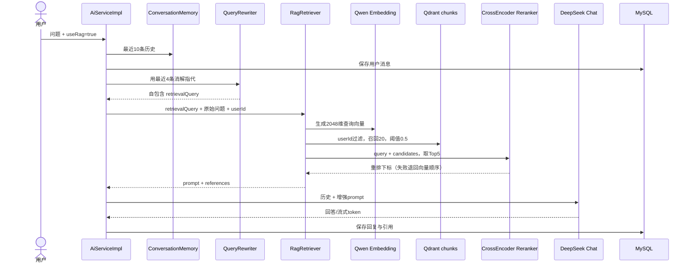

### 4.5 点赞与浏览量

- 点赞：事务内只改 MySQL `note_like`；提交后发 MQ；消费者按数据库重新统计并覆盖 Redis。因此重复或乱序消费最终会收敛。
- 浏览量：请求先初始化 Redis 累计值再 `INCR`，加入 dirty set；定时任务默认每 10 分钟回写 `note_entry.view_count`。
- 这是两种不同一致性策略：低频强事实点赞以 DB 为准；高频低价值浏览先缓存、批量持久化。

### 4.6 SM-2 复习

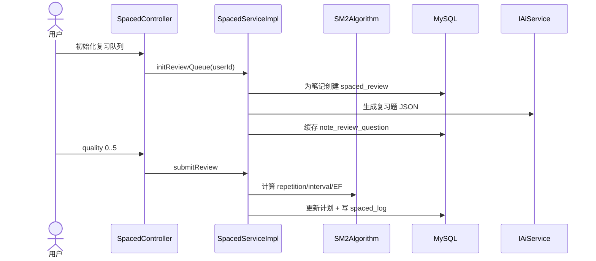

---

## 5. 核心类解析

以下 18 个类覆盖项目最重要的控制点。

| 类 | 核心职责 | 为什么重要 |
|---|---|---|
| [`KnowledgeFlowApplication`](src/main/java/com/ray/knowledgeflow/KnowledgeFlowApplication.java) | 启用 Boot、Scheduling、Async | 运行时总入口 |
| [`SecurityConfig`](src/main/java/com/ray/knowledgeflow/config/SecurityConfig.java) | 无状态 JWT 安全链、CORS、公开路由 | 请求进入业务前的边界 |
| [`JwtAuthenticationTokenFilter`](src/main/java/com/ray/knowledgeflow/security/jwt/JwtAuthenticationTokenFilter.java) | 解析 Token、建立 SecurityContext | userId/角色的来源 |
| [`UserServiceImpl`](src/main/java/com/ray/knowledgeflow/module/user/service/impl/UserServiceImpl.java) | 注册、认证、资料、头像 | BCrypt 与认证管理器实际落点 |
| [`NoteServiceImpl`](src/main/java/com/ray/knowledgeflow/module/note/service/impl/NoteServiceImpl.java) | 笔记事务、版本、链接、事件 | 核心写模型聚合点 |
| [`NoteLinkService`](src/main/java/com/ray/knowledgeflow/module/note/service/NoteLinkService.java) | 解析并持久化稳定双链 | MySQL 图关系事实源 |
| [`ContentSourceServiceImpl`](src/main/java/com/ray/knowledgeflow/module/content/service/impl/ContentSourceServiceImpl.java) | 内容源 CRUD、归属、抓取编排 | 外部数据入口 |
| [`ContentFetchConsumer`](src/main/java/com/ray/knowledgeflow/module/content/message/ContentFetchConsumer.java) | 类型分派、重试触发、同步时间 | 异步抓取工作器 |
| [`SearchServiceImpl`](src/main/java/com/ray/knowledgeflow/module/search/service/impl/SearchServiceImpl.java) | BM25、向量、RRF、精排、索引 | 检索中枢 |
| [`IndexUpdateConsumer`](src/main/java/com/ray/knowledgeflow/module/search/message/IndexUpdateConsumer.java) | 同步 ES、整文向量和切片向量 | 多投影统一重试边界 |
| [`EmbeddingService`](src/main/java/com/ray/knowledgeflow/module/search/service/EmbeddingService.java) | 调 Embedding、管理 Qdrant collection/point | 模型与向量库适配层 |
| [`SemanticChunker`](src/main/java/com/ray/knowledgeflow/module/ai/service/SemanticChunker.java) | 语义边界切片与定长降级 | RAG 索引质量关键 |
| [`ChunkingService`](src/main/java/com/ray/knowledgeflow/module/ai/service/ChunkingService.java) | 分块、注入元数据、向量化、upsert | 索引构建流水线 |
| [`RagRetriever`](src/main/java/com/ray/knowledgeflow/module/ai/service/RagRetriever.java) | 向量召回、精排、Prompt/引用拼装 | 在线 RAG 核心 |
| [`CrossEncoderReranker`](src/main/java/com/ray/knowledgeflow/module/ai/service/CrossEncoderReranker.java) | 调专用重排服务并安全降级 | 精度与延迟的交换点 |
| [`AiServiceImpl`](src/main/java/com/ray/knowledgeflow/module/ai/service/impl/AiServiceImpl.java) | 对话归属、记忆、RAG、同步/SSE 生成 | AI 用例编排器 |
| [`GraphServiceImpl`](src/main/java/com/ray/knowledgeflow/module/graph/service/impl/GraphServiceImpl.java) | MySQL 链接投影到 Neo4j | 多事务管理器样例 |
| [`SpacedServiceImpl`](src/main/java/com/ray/knowledgeflow/module/spaced/service/impl/SpacedServiceImpl.java) | 到期复习、SM-2、AI 出题 | 学习闭环 |

### 5.1 类之间不是平级关系

Controller 只做协议适配；Service 维护用例与业务不变量；Mapper/Repository 处理持久化；Listener/Producer/Consumer 把同步事务与慢任务解耦；Config 决定运行时语义。面试中应按这五层解释，而不是背类名。

---

## 6. 核心技术原理

### 6.1 Spring 事务与 AFTER_COMMIT

默认 `@Transactional` 明确绑定 [`JdbcTransactionManager`](src/main/java/com/ray/knowledgeflow/config/TransactionConfig.java)，Neo4j 使用独立的 `neo4jTransactionManager`。这解决了同时引入 JDBC 和 Neo4j 时 Spring 可能选错默认事务管理器的问题。

`@TransactionalEventListener(phase = AFTER_COMMIT)` 的意义是：只有 MySQL 成功提交后才执行索引/图谱任务。它保证“没有业务数据就没有派生投影”，但不保证投递必达；要达到生产级原子投递仍需 Outbox。

### 6.2 Elasticsearch 的分数

ES 默认以 BM25 为基础计算 `_score`。直觉上：查询词在当前文档出现得越集中，得分越高；在全库越稀有，区分度越高；文档过长会被长度归一化惩罚。本项目额外用字段权重 `title^3`、`summary^2`，并对标题完整短语命中 `boost=8`。不再按 `updatedTime` 强制排序，避免时间覆盖相关度。

### 6.3 Bi-encoder 与 Cross-encoder

- Embedding 是 bi-encoder：查询和文档分别编码，可预计算，适合从海量文档快速召回，但细粒度匹配有限。
- Reranker 是 cross-encoder：把 query 和每个候选一起送入模型，交互更充分、排序更准，但不能预计算，成本与候选数成正比。
- 所以正确结构是“宽召回、小集合精排”，而不是让 cross-encoder 扫全库。

### 6.4 RRF 融合

混合搜索不直接相加 ES 分数与余弦分数，因为两者量纲和分布不同。RRF 只看名次：

```text
score(d) = Σ 1 / (k + rank_i(d)), 本项目 k = 60
```

同一文档在 BM25 和向量两路都靠前会累加优势。RRF 产生候选顺序，cross-encoder 再做最终语义判断。

### 6.5 语义切片

[`SemanticChunker`](src/main/java/com/ray/knowledgeflow/module/ai/service/SemanticChunker.java) 的真实算法：

1. 按中英文标点切句，Markdown 标题独立成语义单元。
2. 每句与前后各 1 句组成窗口，批量生成向量。
3. 计算相邻窗口余弦距离 `1 - cosineSimilarity`。
4. 取本文档距离分布第 85 百分位作为断点；跨文档不使用僵硬绝对阈值。
5. 合并小于 80 字的块，硬拆超过 1000 字的块。
6. Embedding 失败或样本太少时退化为定长切分，保证索引链路可继续。

### 6.6 安全与所有权

认证只证明“你是谁”，业务查询还必须证明“资源属于你”。项目在对话、笔记、内容源、复习等入口把 `userId` 加入 MySQL 条件；向量检索也添加 Qdrant payload filter，并在回源 MySQL 时再过滤一次。后者是纵深防御，防止历史向量缺失 `userId` 时越权。

### 6.7 有界并发与超时

[`AsyncConfig`](src/main/java/com/ray/knowledgeflow/config/AsyncConfig.java) 提供三组有界池：通用 `4/16/500`、AI `2/8/100`、搜索 `4/12/200`。混合搜索两分支并行且各自最多 5 秒；Qdrant/Reranker 超时后有降级路径。核心目的不是“让请求都成功等待”，而是限制资源占用和故障扩散。

---

## 7. 数据库与数据模型

### 7.1 逻辑模型

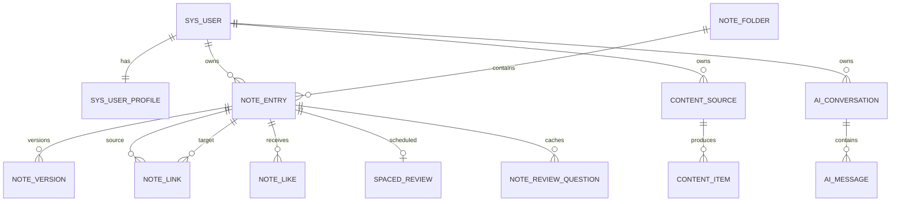

> 这是从 Entity、Mapper 和 SQL 推导的**逻辑关系**。仓库缺少完整基线 DDL，因此不能断言所有关系都已由数据库外键约束。

### 7.2 主要表职责

| 表 | 关键字段 | 设计说明 |
|---|---|---|
| `sys_user` | username/password/status/deleted | BCrypt 密码，逻辑删除 |
| `sys_user_profile` | bio/github_id/preferences/learning_goals/is_public | preferences 用 JSON 类型处理器 |
| `note_entry` | user_id/folder_id/title/content_md/summary/tags/is_public/view_count | 笔记聚合根 |
| `note_version` | note_id/title/content_md | 更新前快照，最多保留 20 个 |
| `note_link` | user_id/source_note_id/target_note_id/link_type | 稳定双链事实源，唯一键防重复 |
| `note_like` | note_id/user_id | 唯一键保证同用户不能重复点赞 |
| `content_source` | user_id/type/url/config/status/last_sync_time | 外部内容源配置 |
| `content_item` | source_id/user_id/title/url/content_text/tags/status | 抓取后统一内容模型 |
| `ai_conversation` | user_id/title/deleted | 会话归属与逻辑删除 |
| `ai_message` | conversation_id/role/content/references | 对话历史与引用 JSON |
| `spaced_review` | user_id/note_id/next_review/interval/repetition/EF | SM-2 状态 |
| `note_review_question` | note_id/question/answer | AI 题目缓存 |
| `spaced_log` | user_id/note_id/quality/duration | 复习行为日志；当前 duration 写 0 |

### 7.3 读写模型

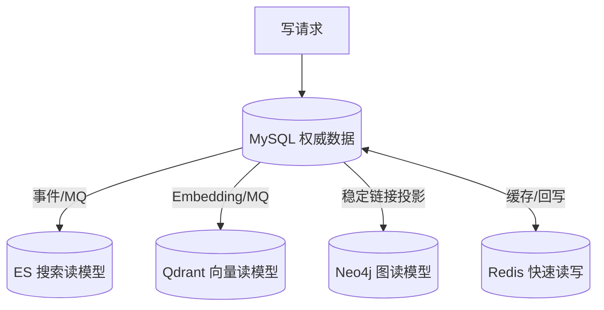

<div class="warning">
<strong>数据库初始化风险</strong><br/>
`docker/mysql/init.sql` 只建库和用户；V2-V8 是零散增量脚本，项目没有 Flyway 依赖，也没有完整 V1 基线。全新环境不能仅靠当前 Compose 自动得到所有业务表，这是启动与交付的首要缺口。
</div>

---

## 8. Redis / MQ / Search 等基础设施

### 8.1 Redis：不是 Session 存储

Security 使用无状态 JWT，Redis 的职责是验证码、互动计数、短时去重和调度防抖。

| Key 模式 | 类型/TTL | 用途 | 一致性策略 |
|---|---|---|---|
| `captcha:{uuid}` | String / 5 分钟 | 注册、登录验证码 | 校验后立即删除，一次性消费 |
| `note:view:{noteId}` | Number / 7 天 | 浏览累计值 | dirty set + 定时回写 MySQL |
| `note:view:dirty` | Set | 待回写 noteId | 成功落库后移除 |
| `note:like:count:{noteId}` | Number / 7 天 | 点赞总数缓存 | MQ 消费者从 DB 重算覆盖 |
| `note:like:user:{noteId}:{userId}` | String / 7 天 | 用户是否点赞 | 更新后失效，下次回源 |
| `msg:dedup:summary:{noteId}` | String / 30 秒 | 摘要任务防抖 | `SET NX` |
| `msg:dedup:tag:{noteId}` | String / 30 秒 | 标签任务防抖 | `SET NX` |
| `dashboard:sync:tags:*` | String / 10 分钟 | Dashboard 标签同步防重 | `SET NX` |

[`RedisConfig`](src/main/java/com/ray/knowledgeflow/config/RedisConfig.java) 使用 JSON value serializer。注意缓存的 key/version 设计：如果 DTO 结构变化，旧 JSON 可能反序列化失败；生产系统通常要加 key 版本或做好兼容。

### 8.2 RabbitMQ 拓扑

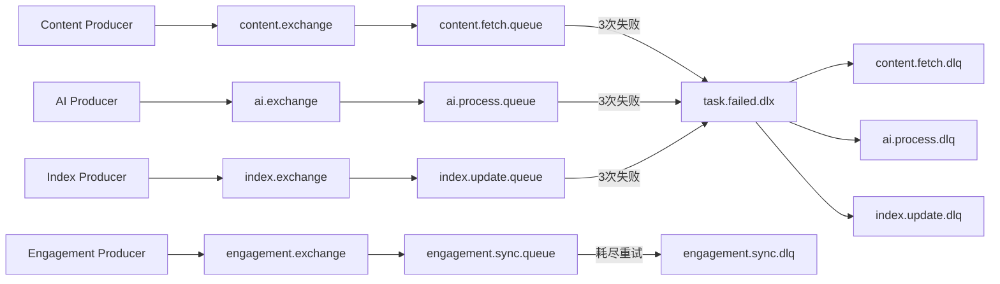

监听器配置是自动 ACK、并发 5 到 10、失败不重新无限入队；指数退避为 500ms、1s、2s，最多 3 次，然后进入 DLQ。Consumer 必须把异常抛出才能触发这套机制，[`IndexUpdateConsumer`](src/main/java/com/ray/knowledgeflow/module/search/message/IndexUpdateConsumer.java) 和 [`ContentFetchConsumer`](src/main/java/com/ray/knowledgeflow/module/content/message/ContentFetchConsumer.java) 已这样处理。

### 8.3 Elasticsearch

- 索引：`note` 和 `content`，定义见 [`NoteDocument`](src/main/java/com/ray/knowledgeflow/module/search/entity/NoteDocument.java)、[`ContentDocument`](src/main/java/com/ray/knowledgeflow/module/search/entity/ContentDocument.java)。
- 用途：中文/英文关键词、标题权重、高亮、分页和近似总数。
- 安全：查询必须带 `userId`；高亮 encoder 为 `html`，未命中回退文本也做 HTML escape。
- 重建风险：`syncAll()` 当前是先删索引内容再重建，没有 alias 蓝绿切换，重建中存在空窗。

### 8.4 Qdrant

| Collection | Point | 用途 |
|---|---|---|
| `content` | 内容项 ID 作为数值 ID，整文向量 | 内容语义搜索、混合搜索 |
| `content_chunks` | UUID，payload 带 sourceId/userId/title/sourceType | RAG 片段召回、笔记相似度 |

向量维度固定为 2048，必须与 `text-embedding-v4` 输出一致。换模型时不能只改名称：维度、历史 collection、重建策略和评测基线都要一起迁移。

### 8.5 Neo4j 与 MinIO

- MySQL `note_link` 是图关系事实源；Neo4j `SimpleNote` 节点与 `LINKS_TO`/`RELATED` 边用于遍历和展示。
- MinIO 保存头像与上传文件。文件入口有大小、MIME、Tika/ImageIO 实体校验，但 Compose 初始化把 bucket 设为公开，生产环境应改私有并用短期签名 URL。

---

## 9. AI / RAG Architecture

### 9.1 模型配置的真实答案

| 环节 | 当前模型/实现 | 调用方式 |
|---|---|---|
| Embedding | 通义千问 `text-embedding-v4`，2048 维 | DashScope OpenAI-compatible `/embeddings` |
| Chat/Generation | `deepseek-chat` | OpenAI-compatible Chat API |
| 默认 Reranker | `BAAI/bge-reranker-v2-m3` | 本地原生 HTTP 或 TEI/Cohere 风格接口 |
| 可选 Reranker | `LlmReranker` / `NoOpReranker` | 配置 `cross-encoder|llm|none` |

配置证据在 [`AiConfig`](src/main/java/com/ray/knowledgeflow/config/AiConfig.java) 与 [`application.yml`](src/main/resources/application.yml)。`pom.xml` 虽保留 zhipu-ai 依赖，但当前注入的 `EmbeddingModel` Bean 明确来自 Qwen 配置；判断实际模型应看 Bean 创建与运行配置，不能只看依赖列表。

### 9.2 离线索引管线

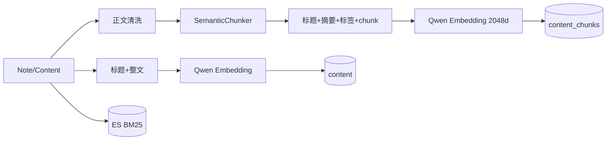

存储 payload 的 `content` 仍是原始切片；生成向量时才把标题、摘要和标签加到前面。这让标题影响召回，又避免最终 RAG 上下文重复大量元数据。

### 9.3 在线检索管线

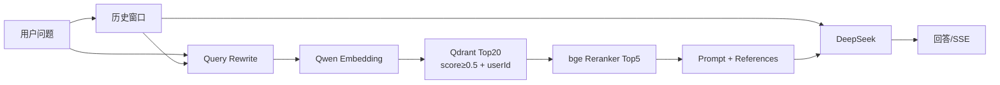

### 9.4 Reranker 策略与降级

[`Reranker`](src/main/java/com/ray/knowledgeflow/module/ai/service/Reranker.java) 是策略接口。Spring 条件装配确保通常只有一个实现：

- `cross-encoder`：精度优先，3.5 秒超时；HTTP 非 2xx、解析失败、越界下标或超时均退回原顺序。
- `llm`：让聊天模型输出下标数组，成本和不确定性更高，适合作为实验。
- `none`：保持召回顺序，专门用于 A/B 对照。

<div class="interview">
<strong>为什么 fallback 很关键？</strong><br/>
重排是质量增强，不应成为搜索和问答的单点故障。降级后相关性可能下降，但基本能力仍可用；同时必须用指标区分“真正重排”和“静默降级”，否则离线评测会误判。
</div>

### 9.5 如何验证 RAG 真实效果

不要用“标题原词查询”证明 RAG 很强，那类用例 BM25 本来就容易。建立固定数据集，至少包含：

1. 不含标题词的同义改写；
2. 需要两个片段联合回答的跨段问题；
3. 多篇高度相似主题中的细节区分；
4. 明确不可回答的问题；
5. 多轮指代追问；
6. 用户隔离与私有内容泄漏测试。

比较 `RERANK_PROVIDER=none` 与 `cross-encoder`，记录 Recall@5、MRR@5、nDCG@5、回答正确率、引用正确率、不可回答拒答率和 p95 延迟。必须记录 reranker 是否实际被调用/是否 fallback，才能把增益归因给模型。

### 9.6 当前 Prompt 风险

当前 Prompt 允许“资料不足时用通用知识补充”，因此它不是严格的知识库问答，可能让不可回答问题看似有答案。更可靠的方案是把“仅基于证据回答”和“通用聊天”做成显式模式，并要求输出 evidence IDs、answerability/confidence；还需隔离检索文本中的 prompt injection。

---

## 10. Agent / Workflow Architecture

### 10.1 结论：当前不是 Agent 系统

源码中没有工具注册/选择、ReAct 循环、Planner、可恢复状态机、LangGraph/Agent 框架或 LLM 自主决定下一步。当前 AI 主链路是 Java 代码写死的确定性 Workflow：历史加载 → 查询改写 → 检索 → 精排 → Prompt → 生成。

| Agent 判据 | 当前状态 | 证据 |
|---|---|---|
| LLM 自主选择工具 | 无 | `AiServiceImpl` 固定调用顺序 |
| 多步计划与反思 | 无 | 无 planner/critic loop |
| 显式工作流状态持久化 | 无 | 仅保存 conversation/message |
| 可恢复节点/检查点 | 无 | MQ 任务有重试，AI 工作流无 checkpoint |
| 确定性编排 | 有 | Java Service/Listener/Consumer |
| LLM 节点 | 有 | 改写、生成、摘要、标签、复习题 |

<div class="concept">
<strong>正确命名</strong><br/>
它是“RAG workflow + event-driven background jobs”，不是“智能 Agent”。Neo4j 的知识图谱也不是 Agent workflow graph。
</div>

### 10.2 如果要演进为 Agent

合理演进不是先引入框架，而是先定义受控工具：`searchNotes`、`searchContent`、`getNoteDetail`、`createDraft`；所有写工具做权限校验与人工确认；限制最大步数、token、时间和调用预算；持久化 step/input/output；把“不可回答”作为终止状态。只有当问题确实需要动态选工具、多步推理时才值得引入 Agent。

---

## 11. Data Flow

### 11.1 数据生命周期

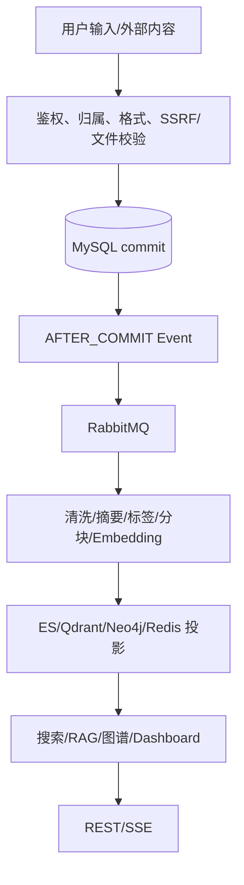

### 11.2 一致性矩阵

| 数据 | 写入一致性 | 读取一致性 | 故障后现象 | 补偿 |
|---|---|---|---|---|
| 笔记与版本/显式链接 | 同一 MySQL 事务 | 强一致（主库） | 全成或全败 | 数据库回滚 |
| ES/Qdrant 索引 | 事务后异步 | 最终一致 | 新内容暂时搜不到 | MQ 重试/DLQ/重建 |
| Neo4j 投影 | JVM 异步事件 | 最终一致 | 图谱滞后 | 手工 rebuild；当前无 durable retry |
| 点赞计数缓存 | DB 事务后 MQ | 最终一致 | 短时旧值 | DB 重算覆盖 |
| 浏览量 | Redis 先写 | 最终持久化 | 崩溃可能丢未回写增量 | 定时 flush，仍有窗口 |
| AI 对话 | MySQL + 外部 LLM | 部分一致 | 用户消息已存但 AI 失败时保存兜底文案 | 重试需产品设计 |

### 11.3 删除传播

删除笔记先校验 owner，再删版本/附件记录/入链/出链，逻辑删除笔记，提交后删除 ES、Qdrant chunks 和 Neo4j 节点。MinIO 实际对象当前可能保留；这既会形成存储泄漏，也可能不满足数据删除合规要求。

---

## 12. 项目启动流程

### 12.1 前置条件

- JDK 17（默认 JDK 8 无法编译 Spring Boot 3）
- Docker Desktop
- Node/npm（需要前端时）
- Qwen Embedding 与 DeepSeek Chat 的有效凭据
- 可选：本机 reranker 需 Python 环境，首次下载约 2.3GB 模型

### 12.2 按需启动

```bash
# 核心：MySQL + Redis + RabbitMQ
docker compose up -d

# RAG/搜索联调
docker compose --profile rag --profile search up -d

# 全套（约 4.5GB 中间件内存，不含 JVM/模型）
./start.sh full

# Apple Silicon 原生 reranker，使用 MPS
cd reranker-service && ./start.sh

# 后端
./mvnw spring-boot:run -Dspring-boot.run.profiles=dev

# 前端
cd frontend && npm install && npm run dev
```

后端基址 `http://localhost:8080/api`，Swagger `http://localhost:8080/api/swagger-ui.html`，前端通常为 `http://localhost:5173`。

### 12.3 启动时发生什么

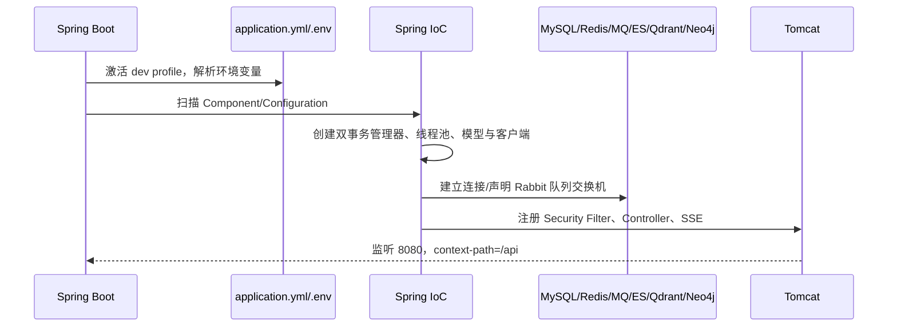

### 12.4 排障顺序

1. `java -version` 确认 17。
2. `docker compose ps` 看依赖健康状态。
3. 检查数据库业务表是否存在；当前脚本不会自动创建完整 schema。
4. `/api/actuator/health` 判断整体状态。
5. 看 `logs/knowledge-flow.log`，按线程名前缀区分 AI/搜索/通用异步。
6. RAG 无结果时依次检查 Qwen 凭据、Qdrant collection、payload userId、索引消息、reranker health。

---

## 13. Source Code Walkthrough

### 13.1 精读一：`NoteServiceImpl.createNote`

入口：[`NoteServiceImpl`](src/main/java/com/ray/knowledgeflow/module/note/service/impl/NoteServiceImpl.java)

1. 校验 folder 是否属于当前用户，防止把笔记挂到他人目录。
2. 构建 `NoteEntry`，为 type/status/public 设置默认值。
3. 用 Jsoup 提取纯文本并截取摘要；这只是同步兜底摘要，不等同于 AI 摘要。
4. 插入 MySQL 后调用 `noteLinkService.syncExplicitLinks`，让正文显式链接与笔记同事务提交。
5. 发布 `NoteSavedEvent` 和可选 `NoteAiProcessRequestedEvent`。
6. 返回详情时再次走 ownership 校验，并读取双向链接、内容引用和附件。

为什么事件在事务内 publish 仍然安全？因为监听器是 `TransactionalEventListener(AFTER_COMMIT)`，回调在提交后触发。为什么仍不完全可靠？因为从 DB commit 到 MQ publish 之间没有原子日志。

### 13.2 精读二：`SearchServiceImpl.searchContentHybrid`

入口：[`SearchServiceImpl`](src/main/java/com/ray/knowledgeflow/module/search/service/impl/SearchServiceImpl.java)

1. 候选数取 `max(pageSize*2, 60)`，避免只对当前页做融合。
2. 用 `searchTaskExecutor` 并行发 ES BM25 和 Qdrant 请求；任一路超时可返回空列表。
3. 对两路名次计算 RRF，不混合原始分数。
4. 在分页前至少取 20 个候选，从 MySQL 按 `userId` 回源正文。
5. 组合“标题、摘要、正文”给 reranker；标题在前，降低长正文截断时丢失强信号的风险。
6. 应用重排下标，未被返回的候选按 RRF 原顺序补齐，最后分页。

关键 trade-off：当前 `total` 是 RRF 候选并集数量，不是全库精确命中数；深分页时只精排前方有限池，搜索产品应限制页深或改 cursor。

### 13.3 精读三：`RagRetriever.retrieve`

入口：[`RagRetriever`](src/main/java/com/ray/knowledgeflow/module/ai/service/RagRetriever.java)

1. `retrievalQuery` 与 `promptQuery` 分离：改写后的问题只用于召回，用户原话用于最终 Prompt。
2. 调 Qwen 生成查询向量；空向量直接降级。
3. 搜 `content_chunks`，限制 20 个、相似度不低于 0.5、必须匹配 userId。
4. 抽取候选正文交给 `Reranker` 取 5 个。
5. 按 sourceId 去重引用，但上下文本身允许同一来源多个相关 chunk。
6. 拼接标题、正文、问题；任何检索异常都返回原始 Prompt，不阻断聊天。

值得修改的点：Prompt 没有结构化证据编号和严格拒答约束；引用分数沿用 Qdrant 原始分数，而非 reranker 分数，前端看到的 score 不代表最终排序强度。

---

## 14. 项目技术难点

### 14.1 多存储一致性

难点不是“接了四个数据库”，而是让 MySQL、ES、Qdrant、Neo4j 在新增、更新、删除和重建时收敛。当前以事实源 + 异步投影解决主路径，通过重试/DLQ提高可恢复性，但仍缺 Outbox 和统一 reconciliation job。

### 14.2 RAG 质量与延迟平衡

语义切片会额外调用 Embedding；候选越多召回越高但 reranker 越慢；chunk 越长上下文完整但噪声和模型截断越大。当前参数 20→5、80~1000 字、rerank 3.5s 是工程折中，不能脱离数据集宣称最优。

### 14.3 多租户数据隔离

同一 ES/Qdrant collection 中存多用户数据，所有查询入口必须加 userId。项目在向量侧和 MySQL 回源侧双重过滤，但相似笔记的一段 Qdrant 查询仍需重点审计是否处处带过滤；这类约束更适合封装为强制 repository API 和自动测试。

### 14.4 外部内容安全

RSS/文件是攻击面：SSRF、重定向绕过、超大响应、伪造 MIME、恶意 HTML、压缩炸弹。项目已加入 public URL 验证、redirect 校验、响应/条目上限、Jsoup sanitization、Tika/ImageIO 校验，但生产还需网络层 egress policy、恶意文件扫描和对象存储私有化。

### 14.5 异步背压

无限线程和无限队列会把下游抖动放大成 JVM OOM。项目使用有界线程池、Rabbit listener 并发和超时；AI 池拒绝策略为 Abort，意味着高峰时应由 API 层明确返回“繁忙/可重试”，而不是只写日志。

---

## 15. Architecture Decisions

| 决策 | Why | 收益 | 代价/适用边界 |
|---|---|---|---|
| 模块化单体 | 项目规模尚不需微服务 | 本地事务、部署简单、调试快 | 模块仍共享进程与数据库 |
| MySQL 作事实源 | 业务修改需要事务与约束 | 可审计、可重建投影 | 异步索引有延迟 |
| AFTER_COMMIT + MQ | 慢任务不阻塞写请求 | 削峰、重试、DLQ | 无 Outbox 时投递非原子 |
| ES + Qdrant | 词法与语义互补 | 精确词和同义表达兼顾 | 运维与一致性复杂度增加 |
| RRF 而非分数加权 | 两路分数不可直接比较 | 参数少、稳健 | 丢失原始分数幅度信息 |
| Cross-encoder 只精排候选 | 精度高但计算昂贵 | 质量/吞吐平衡 | 依赖独立模型服务 |
| 语义切片 + 定长降级 | 提高片段完整性且保证可用 | 索引质量与韧性 | 索引成本更高 |
| JWT 无状态认证 | API 横向扩展简单 | 无服务端 session | 注销/撤销不即时 |
| Redis 浏览量缓冲 | 避免每次浏览写 DB | 高吞吐 | 崩溃窗口可能丢增量 |
| Neo4j 只作投影 | 双链事实应可事务保存 | 图数据可重建 | 投影滞后，需补偿 |

---

## 16. Current Limitations

### 16.1 已确认的事实

1. **缺完整数据库基线和自动迁移**：`init.sql` 不建业务表，Maven 无 Flyway；全新部署不可复现。
2. **DB 与 MQ 非原子**：生产者不具备 Outbox/publisher confirm 全链闭环，提交后故障可能丢索引任务。
3. **Neo4j 同步非持久任务**：监听器捕获异常后只记录，进程退出或写图失败没有自动 durable retry。
4. **同步 AI 调用持有 JDBC 事务**：`sendMessage`、`generateQuestions` 在 `@Transactional` 方法内等待外部模型，可能长期占连接。
5. **JWT 不能即时撤销**：access token 7 天，未见 blacklist/token version。
6. **MinIO bucket 默认公开**：Compose 执行 anonymous public。
7. **严格知识库问答缺失**：资料不足时允许通用知识补充，不可回答评测会受影响。
8. **Reranker 可静默降级**：日志可见但缺业务指标，可能误以为精排一直生效。
9. **ES 重建有空窗**：`deleteAll` 后重新写，无 alias 切换。
10. **复习队列初始化复杂度偏高**：循环 `addNoteToReview` 并同步 AI 出题，大用户可能产生 N 次查询/长事务。
11. **GitHub token 持久化不完整**：profile 实体的 token 字段标为 `exist=false`，无法支撑可靠后台同步。
12. **可观测性不足**：有 Actuator/日志，但缺 traceId、跨 MQ trace、RAG 各阶段 latency/recall/fallback 指标。

### 16.2 假设—证据—验证方法

| 假设 | 当前证据 | 如何验证 |
|---|---|---|
| MySQL 某些查询缺复合索引 | 完整 schema 不在仓库，无法确认 | 导出 `SHOW CREATE TABLE`，对慢查询 `EXPLAIN ANALYZE` |
| 中文 ES 分词效果可能不稳定 | Compose 未明确安装 IK，mapping 未展示自定义 analyzer | `_analyze` 测“算法/垃圾回收”等中文词并检查 mapping |
| RAG 的高召回可能来自测试过易 | 早期用例存在标题/原词命中倾向 | 用同义改写、干扰、跨段、不可答黄金集盲测 |
| 本机 reranker p95 可能超过 3.5s | MPS/文本长度/批量均影响尾延迟 | 固定 20 候选跑 100 次，记录 p50/p95/fallback |
| 图谱同步可能产生 N+1 | `syncNote` 循环查 MySQL 和 Neo4j | 100 条链接压测并统计查询数/耗时 |

<div class="source-focus">
更完整的生产审计与修复记录见 [`docs/tech/07-后端生产优化审计报告.md`](docs/tech/07-后端生产优化审计报告.md)。学习时要区分“已经修复”“仍然待办”和“需要运行环境验证”。
</div>

---

## 17. 面试讲解

### 17.1 30 秒版本

> KnowledgeFlow 是我用 Java 17 和 Spring Boot 3 做的模块化单体知识管理平台。核心数据存 MySQL，通过事务提交后的事件和 RabbitMQ 把数据投影到 Elasticsearch、Qdrant 和 Neo4j。搜索层支持 BM25、纯语义和 ES+Qdrant 的 RRF 混合召回，混合候选再用 bge cross-encoder 精排；RAG 使用千问 text-embedding-v4、语义分块、20 召回 5 精排和 DeepSeek 生成。工程上重点处理了多用户隔离、有界线程池、超时降级、MQ 重试/DLQ、SSRF/XSS 和缓存一致性。

### 17.2 2 分钟版本

按“问题—方案—难点—结果—不足”讲：

1. **问题**：个人信息散落在笔记、订阅和文件中，关键词搜索找不到同义内容，普通聊天模型也不知道私有知识。
2. **方案**：MySQL 统一保存笔记和内容；ES 做 BM25；Qdrant 做向量召回；Neo4j 承载双链投影；RabbitMQ 把抓取、AI 增强和索引移出主事务。
3. **检索亮点**：纯全文、纯语义和混合搜索明确分开。混合搜索并行召回后使用 RRF，避免直接混合异构分数，再用 `bge-reranker-v2-m3` 精排。RAG 对正文做基于相邻句向量距离的语义切片，千问 Embedding 召回 20 个，精排到 5 个交给 DeepSeek。
4. **工程难点**：MySQL 是事实源，其他存储是最终一致投影；所有查询都带 userId；慢外部调用有超时和降级；消费者异常上抛触发重试与 DLQ。
5. **诚实不足**：仍缺完整数据库迁移、事务 Outbox、严格拒答、跨链路可观测性和索引蓝绿重建。这些是下一阶段优先级，而不是声称项目已经“生产完美”。

### 17.3 STAR 深挖案例：为什么“算法”标题没有排第一

- **S**：全文搜索“算法”时，标题含“算法”的笔记未排在首位。
- **T**：确认是 BM25、映射、同步还是业务二次排序覆盖造成。
- **A**：检查 `multiMatch` 后发现结果曾被更新时间重新排序；改为保留 `_score` 主排序，设置 `title^3`、`summary^2`，并对标题短语加 `boost=8`，同时保护高亮免受 XSS。
- **R**：标题强匹配能够优先，同时同分才用时间稳定排序。进一步用同义改写证明这是全文检索改进，不把它误当语义能力。

### 17.4 面试表达禁区

- 不说“微服务”，应说模块化单体。
- 不说“分布式事务已解决”，应说事实源 + 最终一致，并指出 Outbox 缺口。
- 不说“Agent”，应说确定性 RAG workflow。
- 不说“召回率 100%”，应给数据集、指标、样本数和置信范围。
- 不把 Qdrant score、reranker logit、ES `_score` 当作可直接比较的概率。

---

## 18. 面试问题

下面 40 题都应结合本项目回答，不要背抽象定义。

### 18.1 架构与 Spring（1—8）

1. **为什么选择模块化单体而不是微服务？**  
   当前团队和规模下，本地事务、单进程调试和一次部署的收益更大；通过按领域分包保留未来拆分边界，避免提前承担网络、数据一致性和运维成本。

2. **项目的聚合根是什么？**  
   笔记域可把 `NoteEntry` 视为核心聚合根；版本、显式链接、附件等围绕笔记变化。当前实现不完全是严格 DDD，但事务边界体现了聚合思想。

3. **为什么 Controller 不直接调用 Mapper？**  
   归属校验、事务、事件和跨表不变量属于应用服务。绕过 Service 会造成规则散落和安全漏洞。

4. **`@Transactional` 为什么可能失效？**  
   Spring 默认代理机制下，同类内部自调用、非 public 方法、对象非 Spring Bean、异常被吞或抛出非回滚类型都可能让预期事务不生效。还要注意本项目有两个 transaction manager。

5. **为何显式配置两个事务管理器？**  
   JDBC 与 Neo4j 同时自动配置时默认选择可能不确定。项目把 JDBC 设为 `@Primary`，图操作显式用 Neo4j TM，避免 MySQL 方法错误开启 Neo4j 事务。

6. **`AFTER_COMMIT` 解决和没解决什么？**  
   它避免回滚事务产生索引；没解决 DB commit 与 MQ publish 的原子性，也不自动提供重试。

7. **SSE 与普通响应的区别？**  
   普通 Chat 等模型完整返回；SSE 维持长连接逐 token 推送。本项目用 180 秒 emitter 和 AI 有界线程池，完成时保存完整回复。

8. **为什么同步 AI 方法不宜包大事务？**  
   120 秒外部调用可能长期占 JDBC 连接和锁。应把短 DB 事务与外部调用分段，用状态字段/幂等键补偿。

### 18.2 MySQL、Redis、MQ（9—16）

9. **MySQL 为什么是事实源？**  
   用户可编辑数据需要事务、唯一约束和审计；ES/Qdrant/Neo4j 都能由 MySQL 重建，所以定位为读投影。

10. **逻辑删除有什么坑？**  
    关联表可能残留、唯一键可能阻止同值重建、原生 SQL 可能忘记 deleted 条件。项目删除笔记时显式清理版本和链接。

11. **点赞为什么先写 DB，浏览量为什么先写 Redis？**  
    点赞是用户事实且需唯一约束；浏览是高频、可容忍小窗口误差的计数。两者业务价值决定一致性方案。

12. **点赞消费者如何做到幂等？**  
    不对缓存做 `+1/-1`，而是从 DB 重新 count 后覆盖缓存。重复与乱序消息都会收敛到当前事实。

13. **当前 MQ 是否保证 exactly-once？**  
    否。RabbitMQ 常见语义是 at-least-once；业务靠幂等收敛。生产者投递前后还需 confirm、Outbox 与消息 ID。

14. **DLQ 的价值是什么？**  
    把毒消息从主队列移出，避免无限重试阻塞，并留下人工审计/补偿入口；DLQ 本身不是自动修复。

15. **Redis 缓存穿透如何发生？**  
    不存在的 noteId 每次回源会穿透；可缓存空值、做参数/权限校验或布隆过滤。当前互动查询主要面向已存在笔记，仍需考虑恶意 ID。

16. **为什么必须有完整迁移工具？**  
    Entity 不是数据库 schema。Flyway/Liquibase 能保证版本、有序执行、环境一致和发布审计；当前零散 SQL 无法复现新环境。

### 18.3 搜索与向量（17—25）

17. **BM25 的核心直觉？**  
    词在当前文档更集中、在全库更稀有则更重要，同时对文档长度和词频饱和进行修正。

18. **为什么标题命中应加权？**  
    标题是人工浓缩主题，通常比正文偶然出现同词更能代表意图。本项目使用 title boost 与短语 boost。

19. **语义搜索为什么不直接叫混合搜索？**  
    语义搜索只有向量召回；混合搜索明确包含词法和语义两路。能力命名应反映实际算法，便于评测和产品预期。

20. **为什么不能直接相加 ES 和 Qdrant score？**  
    两者量纲、范围、分布随查询变化。RRF 依赖名次，避免脆弱的分数归一化。

21. **RRF 的缺点？**  
    它只看排名，忽略第一名遥遥领先还是仅微弱领先；参数 k 和候选深度仍需评测。

22. **为什么混合搜索也需要 reranker？**  
    RRF 只融合两路名次，并未深入判断 query-document 细粒度关系；cross-encoder 对有限候选做最终排序，特别能处理相似主题干扰。

23. **为什么 rerank 必须在分页前？**  
    如果先分页再重排，真正最相关但在下一页的文档永远无法进入首页，整体排序不正确。

24. **向量维度变更会怎样？**  
    旧 collection schema 与新向量不兼容；需建新 collection、全量重嵌入、双读或 alias 切换，不能原地只改配置。

25. **Qdrant 为什么还要 MySQL 回源？**  
    向量 payload 可能过期或字段有限；MySQL 保证删除状态、用户归属和最新业务字段，形成双重权限收口。

### 18.4 RAG 与 AI（26—34）

26. **RAG 与微调的区别？**  
    RAG 在推理时检索外部证据，更新知识无需训练；微调主要改变行为/风格或内化模式，不适合频繁变化的私有知识事实。

27. **为什么分块质量影响召回？**  
    太小会缺上下文，太大噪声多且易截断；边界切断论述会使正确片段无法独立回答。项目以语义距离找断点并控制 80~1000 字。

28. **语义切片为何使用分位数阈值？**  
    不同文档的距离分布不同，绝对阈值不稳；文档内第 85 百分位能自适应选择显著跳变。

29. **Query Rewrite 的意义？**  
    “那它的缺点呢”无法独立 embedding。用最近历史补全指代能改善召回，但最终 Prompt 仍保留用户原话和历史。

30. **Reranker 为什么比 Embedding 更准却不能替代它？**  
    Cross-encoder 联合编码 query/doc，交互充分，但每个候选都要在线推理；Embedding 可预计算文档向量，适合全库 ANN。

31. **如何证明 reranker 真在工作？**  
    用可控 mock/日志/metrics 记录请求、响应、fallback；同一黄金集切换 `none` 与 `cross-encoder`，比较排序指标和调用成功率，不能只看最终答案。

32. **不可回答问题该怎么处理？**  
    检索阈值只是第一层，还应做 answerability 判定，要求引用证据、限制仅基于资料回答，并设置明确拒答；当前 Prompt 允许通用知识，尚不严格。

33. **如何防 RAG prompt injection？**  
    把检索内容标为不可信数据，系统指令声明不得执行资料内命令；做内容过滤、工具权限隔离、引用输出和攻击用例测试。仅靠字符串拼接不足。

34. **为什么引用 score 可能误导？**  
    当前引用保存的是 Qdrant score，而最终名次由 reranker 决定；不同模型分数也不是概率。UI 应标明含义或保存两阶段分数。

### 18.5 安全、性能与演进（35—40）

35. **JWT 的主要风险与改进？**  
    泄露后在 7 天内可用，服务端不能即时撤销。可缩短 access token、引入 refresh rotation、token version/denylist 和密钥轮换。

36. **为什么 URL 校验还要检查重定向？**  
    攻击者可让公开 URL 302 到 `127.0.0.1` 或云元数据地址；必须逐跳重新校验，并限制协议和跳数。

37. **有界线程池如何选拒绝策略？**  
    CallerRuns 通过让提交线程执行产生自然背压，适合必须推进的通用/搜索任务；Abort 快速失败，适合昂贵 AI，前提是上层返回可理解错误并监控拒绝数。

38. **如何避免索引重建空窗？**  
    创建版本化新索引、全量回填与校验、原子切换 alias，再延迟删除旧索引；Qdrant 也可采用新 collection + alias。

39. **项目应优先加哪些指标？**  
    HTTP p50/p95/error、连接池、MQ lag/retry/DLQ、索引延迟、Embedding/Reranker/LLM latency 与 fallback、Recall@n/nDCG、SSE 中断率、用户隔离拒绝数。

40. **下一步最有价值的三个改造？**  
    先补 Flyway 完整基线保证可部署；再做 Outbox + reconciliation 保证投影可恢复；最后建 RAG 黄金集和严格 answerability，让质量提升可测而不是靠感觉。

---

## 19. Hands-on Tasks

所有任务都要求“先加测试，再改实现，最后写观察结果”。

### Level 1：熟悉代码（半天）

- [ ] 给 Swagger 找出注册、笔记创建、全文搜索、RAG 对话四个接口并完成一次调用。
- [ ] 在调试器里跟一次 `createNote`，记录事务提交点、事件线程名和 MQ message。
- [ ] 切换 `RERANK_PROVIDER=none`，验证 RAG 仍能回答且顺序退回向量结果。
- [ ] 用两位用户创建私有内容，验证 ES、Qdrant 和 AI 对话均不能越权。

验收：提交一张调用链图、一份关键日志和四个接口的请求/响应样例（脱敏）。

### Level 2：可控改动（1—2 天）

- [ ] 为 `RagRetriever` 增加结构化阶段耗时日志：rewrite/embed/vector/rerank/total。
- [ ] 把 RAG prompt 改成可配置的 strict/general 两种模式，并为不可回答写测试。
- [ ] 给全文搜索增加 analyzer 验证脚本，说明中文分词的实际结果。
- [ ] 把 `SpacedServiceImpl.initReviewQueue` 的逐条存在性查询改成批量差集。

验收：单元测试通过，给出改动前后 SQL 数量或延迟对比，不只贴代码。

### Level 3：RAG 实验（2—3 天）

- [ ] 建 50~100 条黄金查询，覆盖同义、跨段、干扰、不可答、多轮和隔离。
- [ ] 跑 `none` 与 `cross-encoder` A/B，输出 Recall@5、MRR、nDCG、p95、fallback rate。
- [ ] 网格实验 candidate `{10,20,40}`、topK `{3,5,8}`、chunk max `{500,1000}`。
- [ ] 人工抽查 false positive/false negative，并把失败归因到 chunk、embedding、filter、rerank 或 generation。

验收：固定数据与脚本可重复运行；报告包含样本数、配置、原始结果和局限。

### Level 4：生产化（3—5 天）

- [ ] 引入 Flyway，生成完整 V1 基线并让空库集成测试自动启动。
- [ ] 为 Note/Content 索引事件设计 transactional outbox、relay、幂等消费和重放命令。
- [ ] 实现 ES alias 蓝绿重建及校验/回滚。
- [ ] 增加 traceId 贯穿 HTTP → event → RabbitMQ → consumer → 外部模型。

验收：模拟 RabbitMQ 停机、Consumer 重复消费、重排超时、应用崩溃后，数据最终收敛且有可观测证据。

### Level 5：受控 Agent（研究项）

- [ ] 只提供只读工具 `searchNotes/getNoteDetail/searchContent`，实现最大 3 步、5 秒、固定 token 预算。
- [ ] 写入动作必须返回 proposed action 并等待人工确认。
- [ ] 与现有固定 RAG workflow 对比成功率、成本和延迟；若无显著收益则不合并。

---

## 20. Learning Checklist

### 20.1 我能解释

- [ ] 为什么 MySQL 是事实源，三种投影分别解决什么问题。
- [ ] Spring Security Filter 如何把 JWT 变成当前用户。
- [ ] 保存笔记后三个异步分支何时发生、失败会怎样。
- [ ] BM25、向量、RRF、cross-encoder 各自处在哪一层。
- [ ] Qwen Embedding 与 DeepSeek Chat 的职责区别。
- [ ] 语义切片算法每一步和参数含义。
- [ ] 为什么当前系统不是 Agent。
- [ ] 点赞与浏览量为何采用不同一致性方案。

### 20.2 我能定位和修改

- [ ] 从一个 API 找到 Controller、Service、Mapper/Repository 和测试。
- [ ] 给一个新字段补 Entity/DTO/SQL/索引/序列化与兼容。
- [ ] 为一个新异步任务设计 queue、retry、DLQ 和幂等策略。
- [ ] 增加 RAG 指标且不泄露用户正文与密钥。
- [ ] 写 ownership 负向测试与跨用户数据测试。
- [ ] 根据 `EXPLAIN ANALYZE` 而不是猜测添加索引。

### 20.3 我能验证

- [ ] 独立启动 core、search、rag profile。
- [ ] 确认 reranker 请求真的发生而不是 fallback。
- [ ] 运行单元测试和 Docker 集成测试。
- [ ] 构造黄金集并计算 Recall/MRR/nDCG。
- [ ] 注入超时、MQ 失败和重复消息，验证降级与最终一致。

---

## 21. 7 天学习路线

| 天 | 主题 | 阅读 | 动手产出 |
|---|---|---|---|
| Day 1 | 全景与启动 | 第1-3、12章，Application/Security | 启动核心服务，画容器和模块图 |
| Day 2 | 用户与笔记 | User/Note Controller、Service、Entity | 跟踪一次 CRUD，写归属校验说明 |
| Day 3 | 事务与异步 | Transaction/Rabbit/Async Config、Listener | 画保存笔记时序，模拟 consumer 失败 |
| Day 4 | 搜索 | SearchService、ES Document | 对 10 条数据比较全文/语义/混合排序 |
| Day 5 | RAG | Chunker、Retriever、Reranker、AiService | 跑 none vs reranker 小型 A/B |
| Day 6 | 图谱/复习/缓存 | Graph、Spaced、Engagement | 跟 SM-2 参数变化，检查 Redis keys |
| Day 7 | 复盘与面试 | 第14-20章 | 做 2 分钟讲解、回答 40 题、选一个 Level 2 任务 |

每天结束必须能回答：今天读的模块事实源是什么？一次失败会在哪被发现？是否会越权？有什么测试证明？

---

## 22. 14 天深入学习路线

| 天 | 深入主题 | 目标与产出 |
|---|---|---|
| Day 1 | 架构地图 | 从 API 到基础设施画完整 C4/模块图 |
| Day 2 | Security | JWT 过滤、BCrypt、OAuth、ownership 威胁模型 |
| Day 3 | MyBatis/事务 | 画聚合事务边界，审计自调用和长事务 |
| Day 4 | 数据模型 | 从 Entity 反推 ER，导出真实 DDL 对差异 |
| Day 5 | Redis | 验证 TTL、回源、dirty flush、缓存异常路径 |
| Day 6 | RabbitMQ | 重试/DLQ/幂等实验，设计 Outbox schema |
| Day 7 | ES/BM25 | mapping、analyzer、boost、高亮安全和 alias 方案 |
| Day 8 | Embedding/Qdrant | collection、维度、payload filter、ANN 误差 |
| Day 9 | Chunking | 用真实长文比较固定、段落和语义切片 |
| Day 10 | Reranker | 跑候选规模/最大长度/批次的质量延迟曲线 |
| Day 11 | RAG Eval | 建黄金集，完成 none/cross-encoder 指标报告 |
| Day 12 | Graph/Spaced | 检查 Neo4j 投影重建与 SM-2 边界用例 |
| Day 13 | Production Hardening | 完成 Flyway 或可观测性中的一个 Level 4 任务 |
| Day 14 | 面试与设计复盘 | 录制 5 分钟讲解，回答深挖，列下一版 ADR |

### 最终毕业标准

你应能在不看 README 的情况下：

1. 从零说明系统边界、六条主链路和四类存储；
2. 现场从 `/search/hybrid` 跟到 ES/Qdrant/RRF/Reranker/MySQL；
3. 用证据解释 reranker 的真实提升和失败降级；
4. 修改一个用例并补齐权限、事务、异步、测试和观测；
5. 坦诚说明项目不是 Agent、不是微服务、也尚未达到完全生产就绪，并给出可执行演进路线。

---

## 附录：关键源码索引

| 主题 | 源码/测试 |
|---|---|
| 启动与配置 | [`KnowledgeFlowApplication`](src/main/java/com/ray/knowledgeflow/KnowledgeFlowApplication.java)、[`application.yml`](src/main/resources/application.yml)、[`docker-compose.yml`](docker-compose.yml) |
| 安全 | [`SecurityConfig`](src/main/java/com/ray/knowledgeflow/config/SecurityConfig.java)、[`UserDetailsServiceImpl`](src/main/java/com/ray/knowledgeflow/security/UserDetailsServiceImpl.java) |
| 笔记 | [`NoteServiceImpl`](src/main/java/com/ray/knowledgeflow/module/note/service/impl/NoteServiceImpl.java)、[`NoteLinkServiceTest`](src/test/java/com/ray/knowledgeflow/module/note/service/NoteLinkServiceTest.java) |
| 内容抓取 | [`ContentSourceServiceImpl`](src/main/java/com/ray/knowledgeflow/module/content/service/impl/ContentSourceServiceImpl.java)、[`ContentFetchConsumerTest`](src/test/java/com/ray/knowledgeflow/module/content/message/ContentFetchConsumerTest.java) |
| 搜索 | [`SearchServiceImpl`](src/main/java/com/ray/knowledgeflow/module/search/service/impl/SearchServiceImpl.java)、[`SearchServiceHybridTest`](src/test/java/com/ray/knowledgeflow/module/search/service/impl/SearchServiceHybridTest.java) |
| 索引 | [`IndexUpdateConsumer`](src/main/java/com/ray/knowledgeflow/module/search/message/IndexUpdateConsumer.java)、[`IndexUpdateConsumerTest`](src/test/java/com/ray/knowledgeflow/module/search/message/IndexUpdateConsumerTest.java) |
| RAG | [`RagRetriever`](src/main/java/com/ray/knowledgeflow/module/ai/service/RagRetriever.java)、[`RagFlowTest`](src/test/java/com/ray/knowledgeflow/module/ai/service/RagFlowTest.java) |
| 分块 | [`SemanticChunker`](src/main/java/com/ray/knowledgeflow/module/ai/service/SemanticChunker.java)、[`SemanticChunkerTest`](src/test/java/com/ray/knowledgeflow/module/ai/service/SemanticChunkerTest.java) |
| 精排 | [`CrossEncoderReranker`](src/main/java/com/ray/knowledgeflow/module/ai/service/CrossEncoderReranker.java)、[`CrossEncoderRerankerTest`](src/test/java/com/ray/knowledgeflow/module/ai/service/CrossEncoderRerankerTest.java) |
| 对话 | [`AiServiceImpl`](src/main/java/com/ray/knowledgeflow/module/ai/service/impl/AiServiceImpl.java)、[`AiServiceRagTest`](src/test/java/com/ray/knowledgeflow/module/ai/service/impl/AiServiceRagTest.java) |
| 图谱 | [`GraphServiceImpl`](src/main/java/com/ray/knowledgeflow/module/graph/service/impl/GraphServiceImpl.java)、[`GraphServiceTest`](src/test/java/com/ray/knowledgeflow/module/knowledge/service/GraphServiceTest.java) |
| 复习 | [`SpacedServiceImpl`](src/main/java/com/ray/knowledgeflow/module/spaced/service/impl/SpacedServiceImpl.java)、[`SpacedServiceSecurityTest`](src/test/java/com/ray/knowledgeflow/module/spaced/service/impl/SpacedServiceSecurityTest.java) |
| 生产审计 | [`07-后端生产优化审计报告`](docs/tech/07-后端生产优化审计报告.md) |
