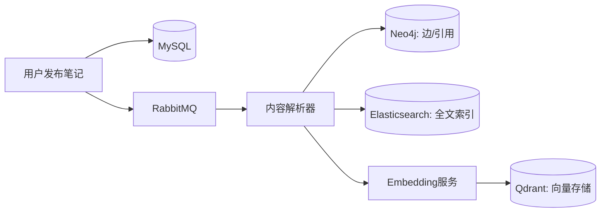
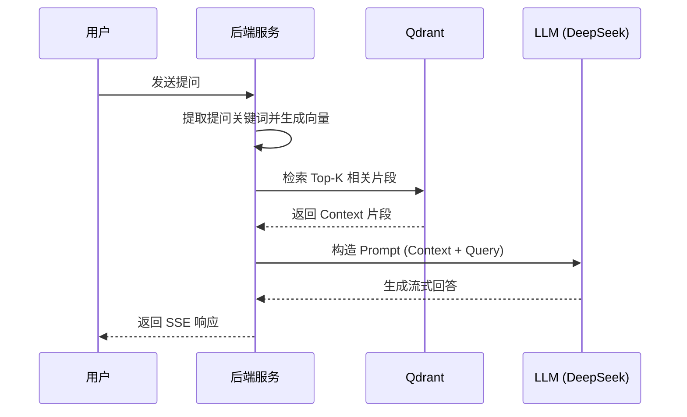

# KnowledgeFlow - AI驱动的知识聚合与学习管理平台

<div align="center">


**一站式知识管理平台 | 智能学习助手 | 个人成长跟踪 | 知识图谱可视化**

[功能特性](#✨-功能特性) · [技术架构](#🛠️-技术架构) · [核心流程](#🔄-核心业务流程) · [快速开始](#🚀-快速开始) · [API文档](#📚-api文档)

</div>

---

## 📖 项目简介

**KnowledgeFlow** 是一款面向开发者和终身学习者的智能知识管理系统（PKM）。它不仅仅是一个笔记应用，更是一个深度融合了大语言模型（LLM）、检索增强生成（RAG）和知识图谱技术的“知识大脑”。

在信息爆炸的时代，KnowledgeFlow 旨在解决知识碎片化、难以检索和遗忘曲线等核心痛点。通过自动化的内容聚合和智能化的关系提取，它能将孤立的知识点编织成一张动态的网，辅助用户实现从“记录”到“内化”的飞跃。

### 核心价值
- **打破知识孤岛**：通过双向链接和 Neo4j 图谱，自动发掘知识点之间的潜在联系。
- **语义化检索**：基于 Qdrant 向量数据库，支持超越关键词的“模糊语义搜索”，即刻找到你“描述”的内容。
- **智能化吸收**：基于 RAG 架构的 AI 助手，能够基于你的个人知识库进行问答、润色、翻译和扩写。
- **科学记忆**：内置改进的 SM-2 间隔重复算法，结合 AI 自动生成的测验题，让复习更有针对性。

---

## ✨ 功能特性

### 🤖 AI 智能助手 (RAG)
- **对话式学习**：基于 LangChain4j，支持 DeepSeek、OpenAI、智谱 AI 等多种模型。
- **精准知识库问答**：采用 RAG 检索增强技术，确保 AI 的回答均有据可循。
- **文本工具箱**：提供一键润色、多语种翻译、内容扩写以及深度解析。
- **流式响应**：支持 SSE（Server-Sent Events）流式输出，提升对话交互体验。

### 📝 现代笔记管理
- **Markdown 全力支持**：集成 Vditor，支持数学公式（KaTeX）、流程图、时序图。
- **双向链接 (Backlinks)**：支持 `[[笔记标题]]` 语法，自动构建笔记间的双向引用流。
- **版本回溯**：完整的笔记修改历史，随时找回灵感初稿。

### 🕸️ 知识图谱可视化
- **立体关系网**：实时生成的 3D/2D 力导向力导向图，直观展示知识节点的连接密度。
- **节点下钻**：点击图谱节点可快速跳转笔记详情，在心流中穿梭知识海洋。

### 📚 多源内容聚合
- **GitHub 订阅**：自动追踪并同步你 Star 的仓库或关注的 Release。
- **arXiv 论文检索**：一键导入学术前沿动态，自动提取摘要。
- **RSS 流量池**：聚合你最爱的技术博客、新闻资讯。

### 🧠 智能记忆系统
- **艾宾浩斯复习**：基于 SM-2 算法，系统自动计算复习优先级。
- **AI 自动出题**：AI 扫描你的笔记内容，自动生成单选题及解析，变被动阅读为主动召回。

---

## 🛠️ 技术架构

KnowledgeFlow 采用了现代化的分布式架构，利用 **混合多存储体系 (Polyglot Persistence)** 来应对不同异构数据的处理需求。

### 后端技术选型
| 技术模块 | 选型 | 说明 |
| :--- | :--- | :--- |
| **核心框架** | Spring Boot 3.5.9 / Java 17 | 高性能、模块化的应用基座 |
| **认证授权** | Spring Security + JWT | 无状态认证，支持 OAuth2 (GitHub) |
| **关系型库** | MySQL 8.0 | 用户权限、评论、点赞等结构化数据 |
| **图数据库** | Neo4j 5.x | 笔记引用链、知识图谱逻辑 |
| **搜索引擎** | Elasticsearch 8.x | 传统词根全文检索，保证精确命中 |
| **向量数据库** | Qdrant | 高维文本嵌入存储，支撑语义搜索 |
| **AI 框架** | LangChain4j | 统一的大模型集成与 RAG 工作流编排 |
| **消息队列** | RabbitMQ 3.x | 异步处理 AI 生成、索引更新等耗时任务 |
| **缓存/频率** | Redis + Redisson | 热点数据缓存及 API 限流 (Resilience4j) |
| **外部存储** | MinIO | 对象存储，管理图片、PDF 及 Markdown 附件 |

### 前端技术选型
- **框架**: Vue 3.x (Composition API)
- **构建**: Vite 5.x
- **UI 组件库**: Element Plus / Naive UI
- **可视化**: D3.js / ECharts
- **编辑器**: Vditor (IR 模式)

---

## 🔄 核心业务流程

### 1. 笔记发布与索引流程


### 2. RAG 智能问答流程


---

## 🚀 快速开始

### 📋 环境要求
- **JDK**: 17+
- **Node.js**: 18.16.0+
- **Docker**: 20.10+ & Docker Compose
- **内存**: 建议 16GB+ (各类数据库容器较多)

### 1. 下载项目
```bash
git clone https://github.com/Ray-Hx/knowlege-flow.git
cd knowlege-flow
```

### 2. 基础设施部署 (Docker One-Click)
```bash
# 赋予执行权限
chmod +x start.sh
# 启动所有依赖 (MySQL, Redis, ES, Neo4j, Qdrant, RabbitMQ, MinIO)
./start.sh
```

全套中间件约占 4.5GB 内存。内存紧张时可按需启动，只拉起当前要调的模块：

```bash
./start.sh core     # MySQL + Redis + RabbitMQ，约 650MB
./start.sh rag      # 核心 + Qdrant，调 RAG 与重排
./start.sh search   # 核心 + Elasticsearch，调搜索
./start.sh graph    # 核心 + Neo4j，调知识图谱
./start.sh storage  # 核心 + MinIO，调文件上传
```

也可直接用 compose，profile 支持叠加：

```bash
docker compose --profile rag --profile search up -d
docker compose stop neo4j          # 单独停某个服务
```

> RabbitMQ 属于核心组：内容抓取、AI 增强和向量索引依赖消息队列。
> 短暂投递失败不会回滚已保存的笔记，但相关异步能力会延迟，
> 应监控 DLQ 并在必要时执行索引/图谱重建。

### 2.1 本地重排服务（可选，用于 RAG 精排）

macOS 上 Docker 无法直通 GPU，因此重排模型以原生进程运行，走 PyTorch MPS 后端：

```bash
cd reranker-service && ./start.sh
```

首次启动会下载模型（约 2.3GB）。详见 [reranker-service/README.md](reranker-service/README.md)。

不启动也不影响使用：后端会在 3.5 秒超时后自动退回向量检索原始顺序。
测试时如需更快失败，可临时设置 `RERANK_TIMEOUT_MS=1500`；这会增加降级比例，
不代表模型推理变快。当前默认精排长度为 512 token、批大小为 8。

### 3. 配置环境变量
复制 `.env.example` 到 `.env` 并填写相关密钥：
```ini
# AI 配置
OPENAI_API_KEY=sk-xxxxxx
OPENAI_BASE_URL=https://api.deepseek.com

# GitHub OAuth (可选，用于第三方登录)
GITHUB_CLIENT_ID=your_id
GITHUB_CLIENT_SECRET=your_secret
```

### 4. 后端启动
```bash
# 使用 Maven 编译并启动
./mvnw spring-boot:run -Dspring-boot.run.profiles=dev
```

### 5. 前端启动
```bash
cd frontend
npm install
npm run dev
```
访问：`http://localhost:5173`

---

## 📁 目录结构

```text
knowledge-flow/
├── docker/                 # Docker 初始化脚本与配置 (MySQL, ES, etc.)
├── frontend/               # Vue 3 前端工程
├── src/main/java/com/ray/knowledgeflow/
│   ├── common/             # 公共组件 (异常、结果封装、工具类)
│   ├── config/             # 系统配置 (Security, MyBatis, Swagger)
│   ├── security/           # JWT 与认证逻辑
│   └── module/             # 业务模块
│       ├── ai/             # AI 助手 (RAG, Chat, Analyze)
│       ├── knowledge/      # 知识图谱与 Neo4j 交互
│       ├── note/           # 笔记 CRUD 与双链解析
│       ├── content/        # 多源内容聚合同步
│       ├── learning/       # 学习进度与打卡热力图
│       └── spaced/         # SM-2 算法与间隔重复复习
├── src/main/resources/
│   ├── application.yml     # 主配置文件
│   └── mapper/             # MyBatis XML 映射
└── start.sh                # 快速启动脚本
```

---

## 📚 API 文档

项目集成 **SpringDoc OpenAPI**，启动后访问：
- **Swagger UI**: `http://localhost:8080/api/swagger-ui.html`
- **文档路径**: `http://localhost:8080/api/v3/api-docs`

---

## 🤝 参与贡献

我们欢迎所有形式的贡献！
1. Fork 本项目。
2. 创建你的特性分支 (`git checkout -b feature/AmazingFeature`)。
3. 提交你的修改并遵循 [Commit 规范](#commit规范)。
4. 推送分支 (`git push origin feature/AmazingFeature`)。
5. 开启一个 Pull Request。

### Commit 规范
- `feat`: 新增功能
- `fix`: 修复缺陷
- `docs`: 文档变更
- `style`: 样式调优 (不影响逻辑)
- `refactor`: 代码重构
- `perf`: 性能优化

---

## 📄 许可证

本项目基于 **MIT** 许可证开源 - 详见 [LICENSE](LICENSE) 文件。

---

## 👨‍💻 作者

**Ray Huang**
- **GitHub**: [@Ray-Hx](https://github.com/Ray-Hx)
- **Email**: [huangrui@example.com]

---

<div align="center">

**如果这个项目对你有帮助，欢迎点一个 ⭐️ Star！**

Made with ❤️ by Ray Huang

</div>

---

## 📖 深入技术文档

若想了解各模块的实现原理、设计取舍与已知局限，见 [`docs/tech/`](docs/tech/00-总览-架构与数据流.md)。

该系列共七篇，以**代码为唯一事实来源**，逐篇讲透分块策略、召回精排、重排降级、RRF 融合、异步一致性与间隔重复算法，并在每篇末尾列出该模块的已知缺陷。

> 本 README 的部分描述与代码存在出入（已知四处，见[总览文档](docs/tech/00-总览-架构与数据流.md)末节）。**如有冲突，以技术文档与代码为准。**
